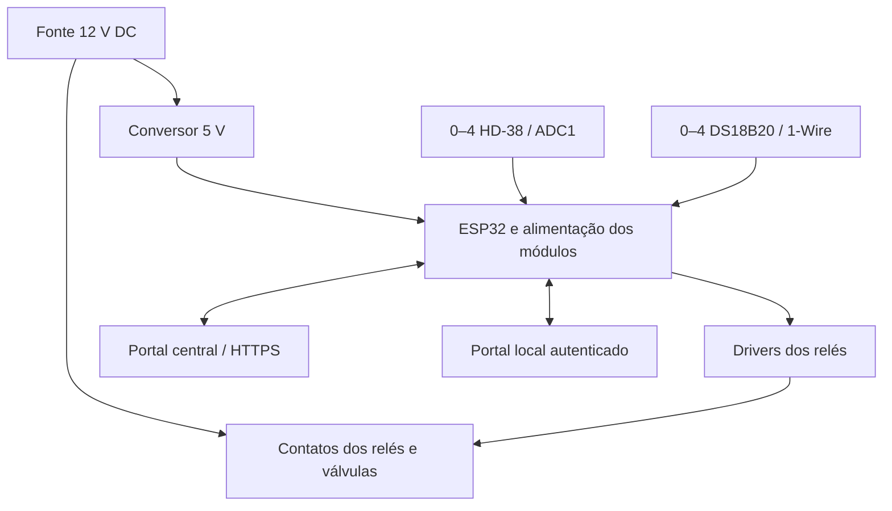
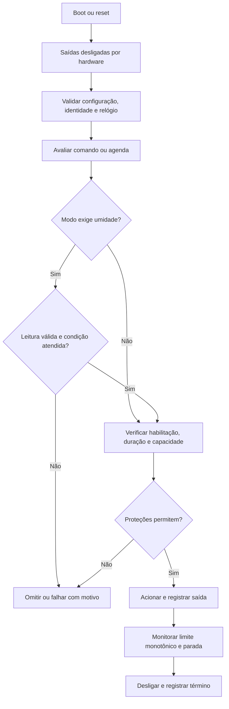

# Arquitetura e fluxos

Documentação proposta. Controle local continua sem Internet quando configuração e relógio permitem; nenhuma rotina de rede deve atrasar parada/limite de duração.

O bloco de alimentação dos módulos segue a tensão real de cada componente. Contatos de potência e comando são circuitos diferentes. O portal central armazena histórico; não é o relógio de duração do dispositivo.

Durante ciclo dinâmico/híbrido, leitura inválida/antiga exige parada; estático/manual não dependem dela. Histórico a cada 900 s não substitui aquisição frequente para controle. Relé acionado não comprova vazão; sem sensor hidráulico registrar saída elétrica, nunca irrigação fisicamente confirmada.

Módulos futuros: drivers de sensores/saídas; controlador local; relógio/calendário; configuração persistente; protocolo HTTP; fila limitada; autenticação/portal local. Estado seguro, watchdog e reconciliação precedem reconexão. Não retomar automaticamente execução interrompida por energia. GUID é identidade, não segredo.
