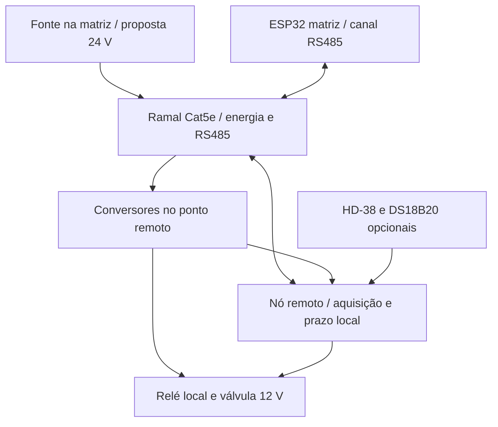

# Placa e cabeamento — adendo 14/10/2026

## Dados informados

- Válvula pretendida de 12 V. AC/DC, corrente e tipo ainda não informados; não presumir DC confirmado.
- Comprimento máximo de cabo: 100 m; Cat5 externo pretendido. Confirmar cobre puro, bitola, resistência, topologia e se a distância se aplica a cada sensor/válvula ou ao tronco.
- Uma válvula por vez é aceitável por limitação da fonte; até quatro juntas é desejado quando fonte **e hidráulica/cabos** permitirem.

## Placa proposta

ESP32-DevKitC V4 com ESP32-WROOM-32E e pelo menos 4 MB de flash; confirmar variante comprada. Não exige PSRAM para protótipo inicial; orçamento TLS/portal/fila será medido. É proposta substituível quando usuário identificar a placa existente. Pinagem de MAPA_PORTAS.md continua preliminar para esse ESP32 clássico.

Referência: https://docs.espressif.com/projects/esp-dev-kits/en/latest/esp32/esp32-devkitc/user_guide.html

## 100 m mudam a arquitetura

Cat5 externo não garante alimentação de válvula ou leitura analógica confiável a 100 m. Usar cobre puro; não assumir CCA equivalente. Referência de cálculo: 9,38 Ω por condutor de 100 m a 20 °C; confirmar datasheet do cabo real. Ida/volta: 18,76 Ω por par de condutores.

Exemplo hipotético de válvula 0,5 A: queda = 0,5 × 18,76 = 9,38 V, restando apenas 2,62 V de uma fonte 12 V. Mesmo quatro condutores paralelos por polaridade dão queda aproximada de 2,35 V, ocupam todos os oito fios e não garantem operação. Fonte com mais amperes não corrige resistência do cabo. Não aumentar tensão de válvula sem especificação do fabricante.

Sensores HD-38 AO: não aprovar 100 m de saída analógica até ADC central sem condicionamento e ensaio. DS18B20: 1-Wire longo depende de topologia, capacitância, alimentação e master; GPIO com resistor 4,7 kΩ não é garantia de 100 m.

Referências: https://www.furukawalatam.com/sfc/servlet.shepherd/version/download/06861000002pt0HAAQ?asPdf=false e https://www.analog.com/en/resources/technical-articles/guidelines-for-reliable-long-line-1wire-networks.html

## Alternativas propostas

1. Protótipo econômico: controlador próximo de sensores/válvulas, cabos curtos, fonte local. Aproveitar GUID por área e Wi-Fi se cobertura comprovada.
2. Campo com tronco 100 m: sensores/driver próximos de nó remoto; transportar dados por RS485 com proteção e alimentação dimensionada/local. HD-38 e DS18B20 permanecem locais ao nó. Definir identidade e protocolo do nó antes de implementação.
3. Uma central com cargas remotas: alimentação das válvulas por cabo de potência calculado separado; sensores com aquisição remota/RS485. Exige orçamento adicional.

Se não houver energia local, estudar distribuição em tensão maior com conversores locais e cálculo de potência/quedas/proteção, sem aplicar essa tensão diretamente às válvulas 12 V. Não comprar fonte/cabo final antes de conhecer corrente e distâncias por ramal.

Estado: planejamento; sem bancada, firmware ou aprovação final de arquitetura. Começar simultaneidade física em 1, testar e liberar até 4 somente após dimensionamento elétrico/hidráulico.

## Topologia esclarecida pelo usuário — 14/10/2026

Os 100 m atendem sensores e válvulas. Toda energia parte da matriz; não há fonte independente no ponto remoto. Conversores no ponto remoto não são fontes independentes: recebem energia pelo cabo da matriz.

Proposta para avaliação: estrela de até quatro ramais Cat5e externo cobre puro. Um par reservado a RS485 A/B, três pares para alimentação: três condutores positivos e três retornos, agrupados de modo que cada par contenha positivo e retorno. Não misturar comunicação com um par de alimentação nem usar RJ45 como Ethernet/PoE convencional. Este é enlace proprietário, sem compatibilidade PoE garantida. Pinout físico definitivo, conector, bitola/proteção e corrente admissível ainda não aprovados.

Matriz: ESP32-DevKitC V4, fonte de distribuição proposta 24 V DC e proteção/fusível por ramal. Cada ramal usa canal RS485 independente (transceptor/UART ou multiplexação a projetar); não conectar quatro cabos longos em estrela num único barramento RS485 passivo.

Ponto remoto: pequeno nó de aquisição/controle, transceptor RS485 compatível com a lógica local, conversores 24→12 V para válvula e alimentação lógica, leitura HD-38 e DS18B20 próximos, relé/driver local com estado desligado. Relé remoto elimina transportar GPIO e corrente de bobina desde a matriz. MCU remoto não precisa ser outro ESP32; selecionar opção barata somente após orçamento e ensaio. Todos os componentes continuam opcionais conforme conjunto.

A válvula recebe **12 V regulados**, nunca 24 V. Outra opção é distribuição 48 V com conversores adequados, caso perdas/correntes tornem 24 V inviável; decisão ainda não tomada. Tanto 24 V quanto 48 V exigem verificação de cabo, potência, transientes e fonte. Não garantir quatro válvulas por fonte sem correntes reais.

Exemplo de primeira estimativa: três condutores em paralelo por polaridade dão resistência de laço 18,76/3 = 6,25 Ω a 100 m e 20 °C. Com 0,35 A no ramal, queda ≈2,19 V e perda ≈0,77 W. Corrente real depende da carga/conversão/tensão recebida; resolver e medir em carga, especialmente partida e temperatura. Não usar esta estimativa para selecionar corrente de fusível ou comprar fonte.

Válvula indicada: https://www.mercadolivre.com.br/valvula-solenoide-12v-34--agua-automacao-arduino-irrigacao/up/MLBU759761240 . Página completa bloqueou consulta; resultado indexado do próprio anúncio informa pressão de operação 0,02–0,8 MPa (0,2–8 bar). Confirmar manual/etiqueta/modelo: AC/DC, corrente nominal/pico, regime contínuo, normalmente fechada, direção e pressão diferencial. Ausência de necessidade de bomba no projeto não significa ausência de pressão mínima da válvula. Uso proposto é rede pressurizada, sem adicionar bomba por padrão.

HD-38 e DS18B20 permanecem próximos do nó remoto; transporte longo por RS485. Novo protocolo nó/matriz precisa de timeout, leitura com qualidade/idade, checksum, identificação por ramal/nó e comando com prazo local. Perda de comunicação ou reset desliga relé local; limite de duração no nó evita depender da matriz para parar. GUID público permanece no ESP32 matriz; nó tem identificador subordinado, não redefine identidades/histórico existentes.

Pendências principais: corrente/modelo da válvula, placa do relé, especificação do cabo, quantos ramais/pontos por cabo, orçamento e comparação nó remoto vs interfaces comerciais. Nenhum circuito de 100 m aprovado ou validado fisicamente.
