# Manual ilustrado — Portal local do ESP32

**Conecta Agro · firmware 0.6.0 experimental · 17/10/2026**

Este manual mostra o portal que acompanha o firmware do ESP32. As imagens foram capturadas em navegador a partir da **mesma página embutida na flash**, com uma API de demonstração no computador. Nomes, IP, rede, sensores, registros e estados de saída são fictícios. Nenhuma placa ou válvula foi acionada.

O portal central, executado em Node.js/Railway, é outra aplicação. Este documento é sobre o painel acessado pelo **IP da placa**. Para instalar e acessar pela primeira vez, siga o [guia de primeiro acesso](../PRIMEIRO_ACESSO_ESP32.md).

## Navegação rápida

1. [Primeiro acesso e perfis](#1-primeiro-acesso-e-perfis)
2. [Operação e teste](#2-operação-e-teste)
3. [Configuração do dispositivo](#3-configuração-do-dispositivo)
4. [Componentes e conjuntos](#4-componentes-e-conjuntos)
5. [Agendas semanais e por data](#5-agendas-semanais-e-por-data)
6. [Aplicar, importar e exportar](#6-aplicar-importar-e-exportar)
7. [Sensores e calibração](#7-sensores-e-calibração)
8. [Eventos locais](#8-eventos-locais)
9. [Fila de envio](#9-fila-de-envio)
10. [Wi-Fi, contas e integração central](#10-wi-fi-contas-e-integração-central)
11. [Recuperação e backup](#11-recuperação-e-backup)
12. [Uso pelo celular](#12-uso-pelo-celular)
13. [Problemas frequentes](#13-problemas-frequentes)
14. [Como as imagens foram produzidas](#14-como-as-imagens-foram-produzidas)

## 1. Primeiro acesso e perfis

Depois de compilar/gravar e cadastrar rede e senhas por USB:

1. Conecte o computador ou celular à rede que alcança a placa. O Wi-Fi do ESP32 clássico utiliza 2,4 GHz.
2. Obtenha o IP pelo roteador ou pelo monitor Serial; a mensagem esperada informa `portal http://IP/`.
3. Abra `http://IP_DA_PLACA/` no navegador. O endereço `192.0.2.10` das imagens é ilustrativo: use o IP real.
4. Na solicitação de autenticação do navegador, entre com `admin` ou `operador` e a senha cadastrada.

A autenticação é HTTP Basic: não existe uma página interna com formulário de login para ilustrar. O firmware padrão não traz uma senha compartilhada. A conta operador é opcional e precisa ter sido cadastrada. O navegador pode conservar a autenticação; depois de alterar uma senha, poderá pedir as novas credenciais.

| Perfil | O que pode fazer no portal local |
|---|---|
| Administrador | Consultar todas as abas, configurar quando a edição local é permitida, calibrar onde há aquisição local e administrar rede, acessos e fila. |
| Operador | Consultar Operação e Eventos; solicitar teste/parada quando permitidos. Não altera configuração, calibração, fila ou credenciais. |

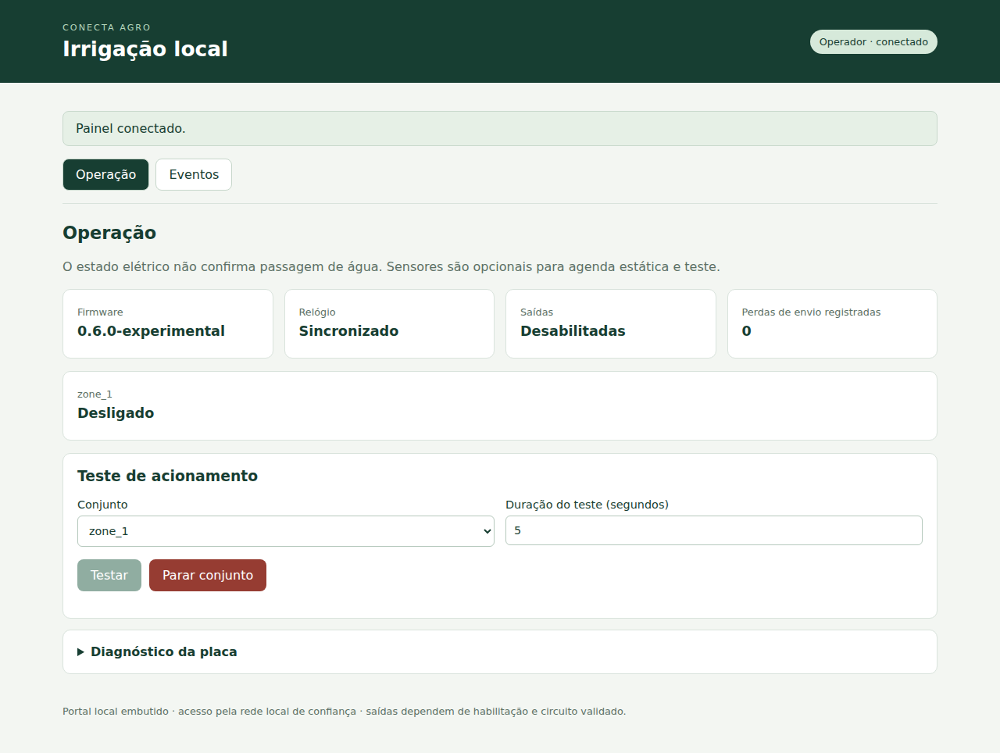

*Demonstração do perfil operador. O menu reduzido é esperado; não significa que a instalação perdeu funções.*

O painel local usa HTTP e deve ficar em rede confiável, sem exposição direta à Internet. Não substitui a preparação de segurança de produção. O primeiro teste na placa deve usar o perfil padrão e **saídas físicas desabilitadas**.

## 2. Operação e teste

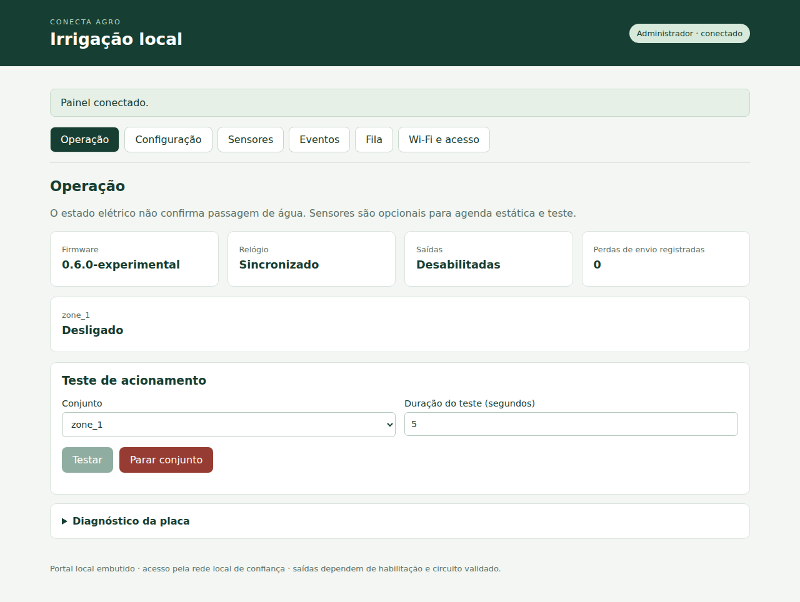

Na aba **Operação**, confira:

| Campo | Como interpretar |
|---|---|
| Firmware | Versão executada pelo dispositivo. |
| Relógio | Sincronizado ou aguardando sincronização. Agendas e novas partidas dependem das condições do controlador. |
| Saídas | Indica se o acionamento físico foi habilitado no firmware. A configuração lógica no portal não altera esse parâmetro. |
| Perdas de envio registradas | Contador de falhas/perdas de enfileiramento; não significa automaticamente perda de todo o histórico local nem confirma recuperação remota. |
| Cartão do conjunto | Desligado, em execução ou com estado elétrico desconhecido. A interface utiliza o ID do conjunto, por exemplo `zone_1`. |
| Diagnóstico da placa | Detalhes técnicos, permissões e condições atuais; abra apenas quando precisar investigar. |

### Testar e parar um conjunto

Somente depois da validação do circuito e da habilitação física apropriada:

1. Selecione o conjunto.
2. Informe uma duração entre **1 e 30 segundos**; o limite de segurança do conjunto também se aplica.
3. Clique em **Testar**.
4. Confira a resposta e o cartão do conjunto. Uma solicitação não deve ser interpretada como prova de vazão.
5. Para interromper, clique em **Parar conjunto** e confira o retorno.

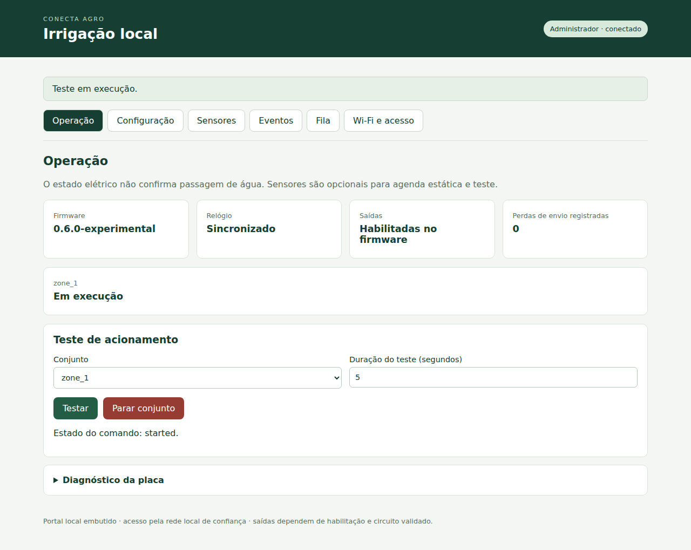

*Somente nesta demonstração de teste, a API fictícia informa saídas habilitadas. `started` representa o retorno de início; `completed`, o retorno de término/parada. A captura não demonstra acionamento de hardware.*

Um botão **Testar** desabilitado pode ser normal: saídas desabilitadas, relógio inválido, recuperação bloqueada, ausência de conjunto, permissão insuficiente ou comunicação indisponível. O nó remoto tem restrições próprias de comando; não funciona como uma bancada independente.

**Saída acionada não comprova válvula aberta ou passagem de água.** Essa confirmação exige instrumentação e ensaio físico. A parada e os limites de duração não devem depender da Internet.

## 3. Configuração do dispositivo

Abra **Configuração** e clique em **Carregar da placa** quando necessário. Os campos aparecem no editor; editar ainda não grava nada no dispositivo.

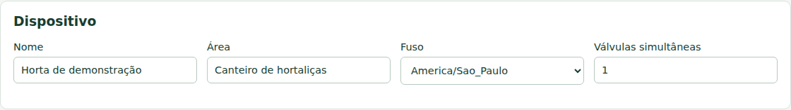

- **Nome:** identificação amigável do dispositivo.
- **Área:** descrição do local atendido.
- **Fuso:** calendário local das agendas. Para o horário de Brasília atual, selecione `America/Sao_Paulo`. O firmware oferece catálogo IANA; a demonstração usa uma seleção reduzida.
- **Válvulas simultâneas:** limite lógico de 1 a 4. O padrão é 1; aumentar exige capacidade elétrica e hidráulica validada.

Nome, área e IP não substituem o GUID persistente da placa. Alterar esses campos não deve criar outro dispositivo.

### Quando o portal central é a autoridade

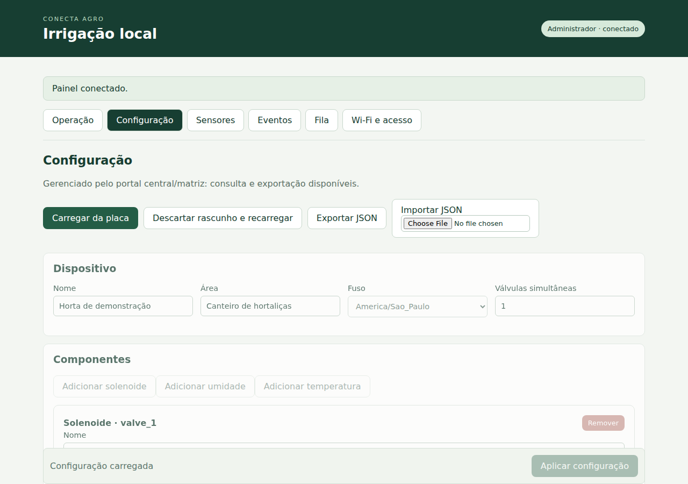

*Recorte da parte superior do editor em modo de consulta.*

Com gestão central, a aba informa **Gerenciado pelo portal central/matriz** e o editor fica bloqueado. Faça a alteração no portal central e aguarde sua aplicação no dispositivo. A edição local é destinada à operação independente quando permitida; o nó remoto também tem restrições. Não tente contornar a autoridade alterando o JSON.

## 4. Componentes e conjuntos

### Cadastrar componentes

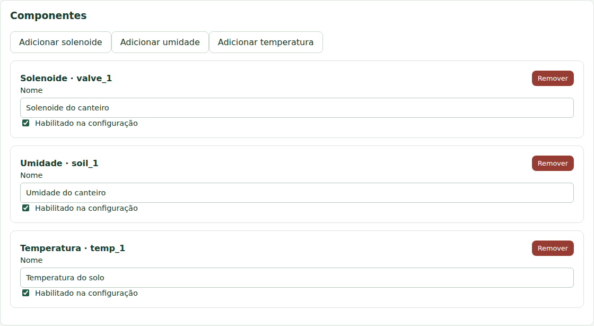

Use os botões **Adicionar solenoide**, **Adicionar umidade** e **Adicionar temperatura**, conforme a instalação. É possível ter de zero a quatro de cada tipo.

Dê nomes claros e confira a opção de habilitação. Os IDs, como `valve_1`, `soil_1` e `temp_1`, relacionam os registros e os vínculos físicos. A posição de um componente na lista não define o GPIO. Não reutilize a identidade de um componente histórico para representar outro equipamento.

Cadastrar um sensor ou marcar **Habilitado na configuração** não instala o hardware nem modifica pinos. Sensores opcionais podem ser omitidos; uma instalação sem solenoides pode ser apenas de monitoramento.

### Montar um conjunto

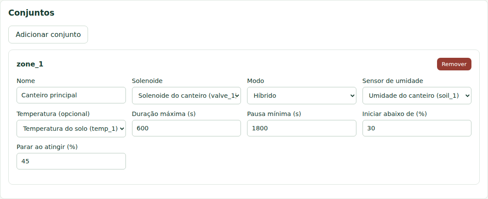

Em **Conjuntos**, clique em **Adicionar conjunto** e associe uma solenoide disponível. Se instalado, associe o sensor de umidade e a sonda de temperatura.

| Modo | Funcionamento |
|---|---|
| Estático | Executa a agenda por horário, sem exigir sensor de umidade. |
| Dinâmico | Inicia abaixo do limite de umidade e para ao atingir o alvo ou uma proteção. Exige leitura de umidade válida. |
| Híbrido | Aplica a condição de umidade dentro da janela da agenda. A duração da janela não obriga a válvula a permanecer ligada por todo o período. |

No exemplo híbrido: início abaixo de **30%**, alvo **45%**, duração máxima **600 s** e pausa mínima **1.800 s**. São valores didáticos, não uma recomendação agronômica. A escala de umidade é relativa à calibração; temperatura é monitoramento nesta etapa e não aciona irrigação.

Uma solenoide pertence a um conjunto. Antes de remover um componente ou conjunto referenciado por uma agenda, remova ou ajuste a referência; a interface rejeita referências quebradas.

## 5. Agendas semanais e por data

### Dias da semana com horários independentes

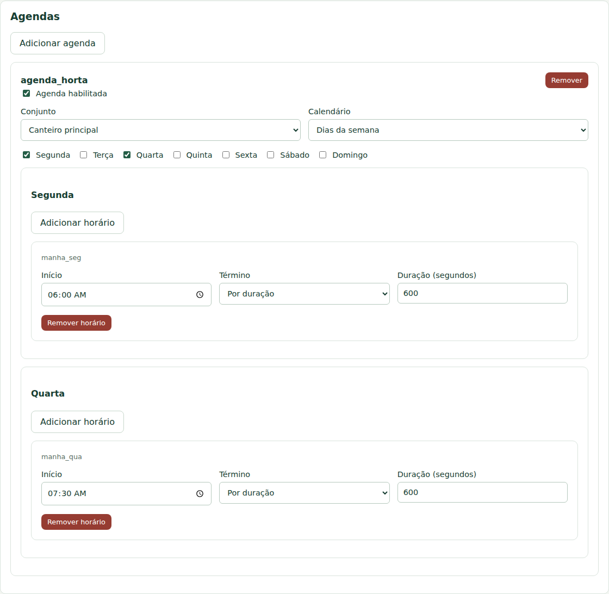

1. Em **Agendas**, clique em **Adicionar agenda**.
2. Selecione o conjunto e mantenha **Agenda habilitada** quando desejar ativá-la.
3. Em **Calendário**, escolha **Dias da semana**.
4. Marque cada dia desejado.
5. Preencha os horários de cada dia separadamente. **Adicionar horário** acrescenta outra ocorrência naquele dia.
6. Selecione o término por duração ou por horário.

Na imagem, segunda-feira começa às **06:00** e quarta-feira às **07:30**. Em cada dia, **600 segundos** correspondem a dez minutos. Alterar a quarta-feira não altera a segunda-feira.

A exibição nativa dos campos de hora depende do navegador/sistema: pode aparecer `06:00 AM` em vez de `06:00`. Confira AM/PM quando presente; `12:00 AM` é meia-noite e `12:00 PM` é meio-dia.

### Data específica e passagem pela meia-noite

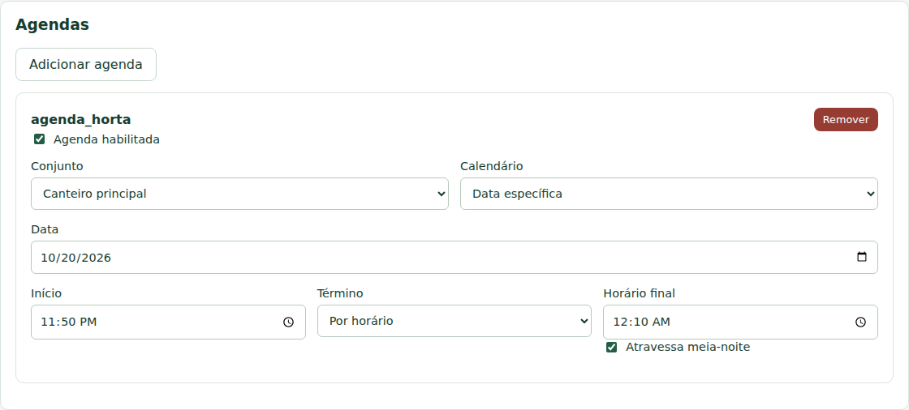

Para uma ocorrência por data:

1. Selecione **Data específica**.
2. Escolha a data, por exemplo **20/10/2026**.
3. Preencha o início e o tipo de término.
4. Se o término for no dia seguinte, marque **Atravessa meia-noite** explicitamente.

A imagem ilustra **23:50–00:10 do dia seguinte**. O controle de data da captura está em formato mês/dia/ano: `10/20/2026` significa **20/10/2026**; o formato exibido depende do navegador. Por horário final e por duração são alternativas; não preencha duas regras de término para a mesma ocorrência. Não use horários iguais para inferir automaticamente 24 horas.

O calendário aceita anos de 2020 a 9999, com tempo de 64 bits; não há corte em 2037. Em mudanças de horário de verão, uma hora inexistente é omitida e uma hora repetida utiliza o primeiro instante. As regras refletem a base IANA embarcada: futuras mudanças legais exigem atualização do firmware. Isso não representa uma garantia ilimitada de sincronização SNTP.

O dispositivo tem limites de **32 agendas**, **64 horários expandidos** e até **oito horários por dia** em cada agenda semanal. O tamanho total da configuração também é limitado. Agendas perdidas não devem ser executadas tardiamente após reinício.

## 6. Aplicar, importar e exportar

Depois de editar:

1. Confira componentes, referências, modo, horários e limites.
2. Observe **Alterações ainda não aplicadas**.
3. Clique em **Aplicar configuração** e aguarde a confirmação de persistência/revisão.

A aplicação exige permissão e controlador ocioso. A placa calcula o hash e verifica a revisão; se outra atualização ocorrer enquanto você edita, poderá recusar o rascunho. Exporte-o antes de carregar a versão atual, se precisar conservar suas alterações.

- **Exportar JSON:** salva a configuração lógica carregada/rascunhada. Não é backup completo da placa e não inclui o provisionamento secreto.
- **Importar JSON:** carrega um arquivo no rascunho; ainda será necessário aplicar.
- **JSON completo · opções avançadas:** editar a caixa e usar o JSON no formulário também não grava automaticamente.
- **Descartar rascunho e recarregar:** substitui as alterações locais pela configuração da placa.

Perder comunicação não significa que a última gravação falhou ou foi concluída. Reconecte e confira a revisão antes de repetir. Evite fechar ou atualizar a página com alterações não aplicadas.

## 7. Sensores e calibração

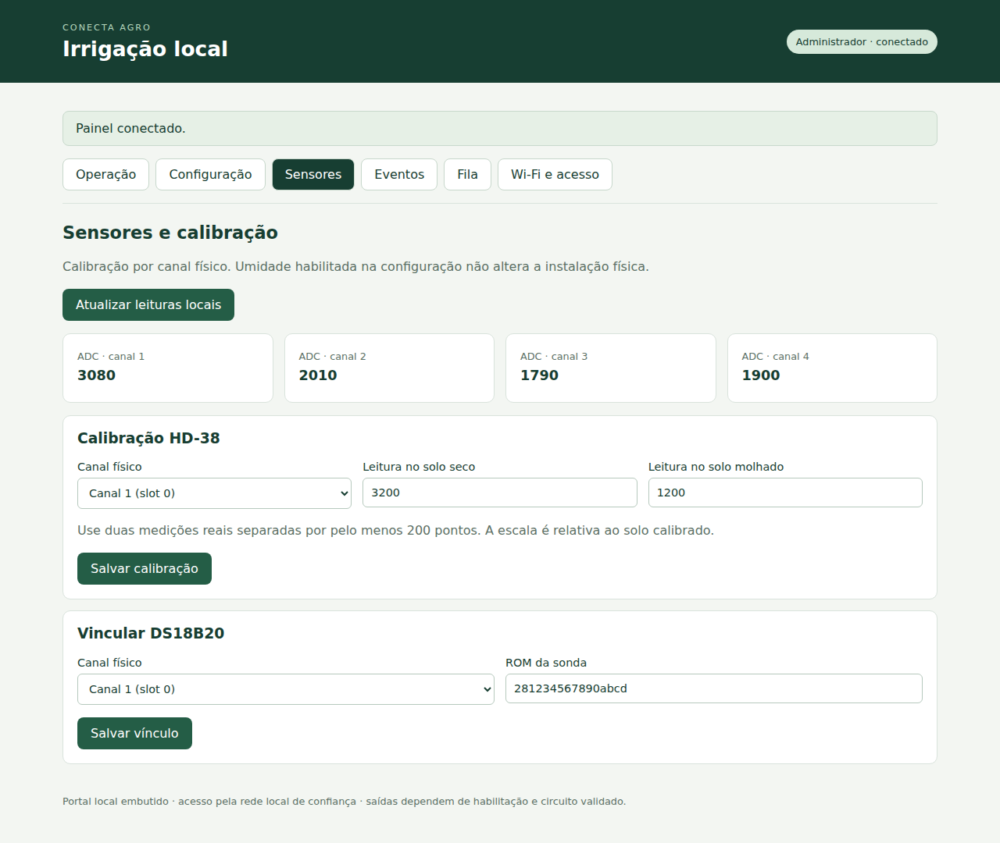

A aba **Sensores** mostra leituras ADC locais e formulários de calibração/vínculo. A imagem representa o perfil **bancada**, com aquisição local fictícia. Na matriz, a calibração deve ser feita na bancada ou no nó que efetivamente lê o sensor; campos podem ficar bloqueados.

### HD-38 — umidade relativa calibrada

1. Escolha o **Canal físico** correto; slot 0 corresponde ao primeiro canal.
2. Faça uma medição real no solo seco e outra no solo molhado, nas condições de uso.
3. Informe os valores em **Leitura no solo seco** e **Leitura no solo molhado**.
4. Clique em **Salvar calibração**, com o controlador ocioso.

São aceitos valores de **0 a 4095**, separados por pelo menos **200 pontos**. Os números 3200 e 1200 da demonstração são fictícios: não os copie como calibração de uma instalação real. O percentual resultante é relativo à calibração daquele solo; não é automaticamente umidade volumétrica.

### DS18B20 — vínculo da sonda

Escolha o canal, informe/selecione a **ROM da sonda**, com 16 caracteres hexadecimais, e clique em **Salvar vínculo**. Use a ROM realmente detectada; a mostrada na imagem é ilustrativa. Não vincule sondas pela ordem de descoberta. No nó remoto de referência, apenas o slot 0 é disponibilizado.

## 8. Eventos locais

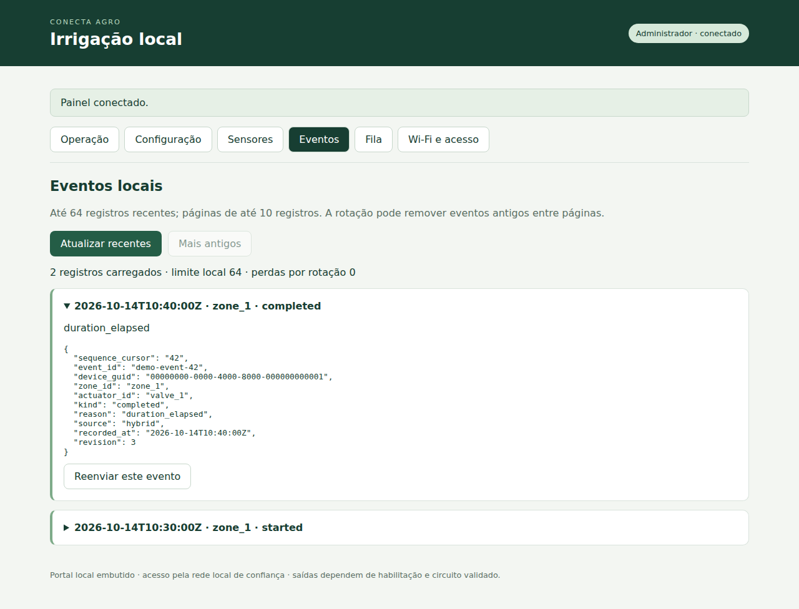

- **Atualizar recentes:** recarrega os registros mais novos.
- **Mais antigos:** busca a próxima página quando houver mais registros disponíveis.
- Clique no título do evento para abrir seus detalhes.
- **Reenviar este evento:** disponível ao administrador em registros elegíveis; enfileira o evento com a identidade original. Não repete uma irrigação.

O anel local guarda até **64 eventos**, com páginas de até dez. Registros antigos podem sair do anel entre consultas. Os horários ISO com `Z` estão em **UTC**; por exemplo, `10:30Z` equivale a 07:30 no fuso de São Paulo atual. Horário desconhecido não deve ser interpretado como meia-noite ou zero.

O reenvio conserva o `event_id` para deduplicação central. Não recupera amostras de sensores, registros já rotacionados ou eventos legados sem identidade/horário/revisão necessários. Também depende de integração, fila e condições da placa. Um registro na auditoria não comprova vazão física.

## 9. Fila de envio

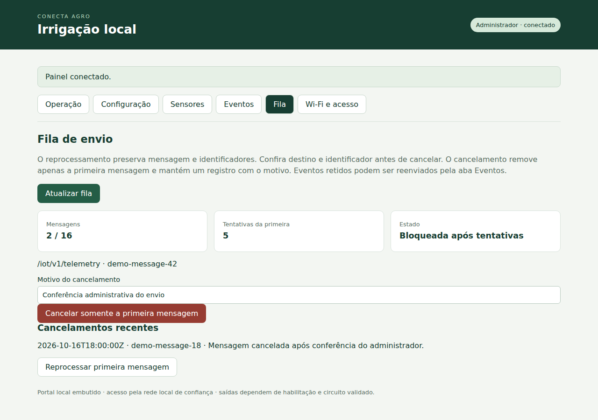

Confira a contagem de mensagens, as tentativas e o estado da primeira mensagem. O limite local é **16**. **Bloqueada após tentativas** indica que o envio não continuará normalmente sem tratamento da causa.

### Reprocessar

Corrija o problema de autenticação, certificado, conexão ou servidor e clique em **Reprocessar primeira mensagem**. O conteúdo e os identificadores são preservados. O botão não conserta um token inválido nem comprova que o destino já recebeu os dados.

### Cancelar somente a primeira mensagem

1. Clique em **Atualizar fila**.
2. Confira caminho e identificador da primeira mensagem.
3. Preencha **Motivo do cancelamento** em até 120 bytes.
4. Clique em **Cancelar somente a primeira mensagem**.
5. Confira a nova contagem e o histórico recente de cancelamentos.

A operação exige administrador, CSRF válido, ociosidade e ausência de envio em andamento. Se a cabeça mudou desde a consulta, a placa recusa o cancelamento: atualize e confira novamente. A contagem em caracteres pode ser menor que 120 se houver acentos, pois o limite é em bytes.

O registro do cancelamento acompanha o avanço da fila; ficam oito registros recentes e um contador acumulado. Não há limpeza em massa. Cancelar uma mensagem não apaga o evento da auditoria: um evento retido ainda pode ser reenviado. Trocar o destino central exige fila vazia.

## 10. Wi-Fi, contas e integração central

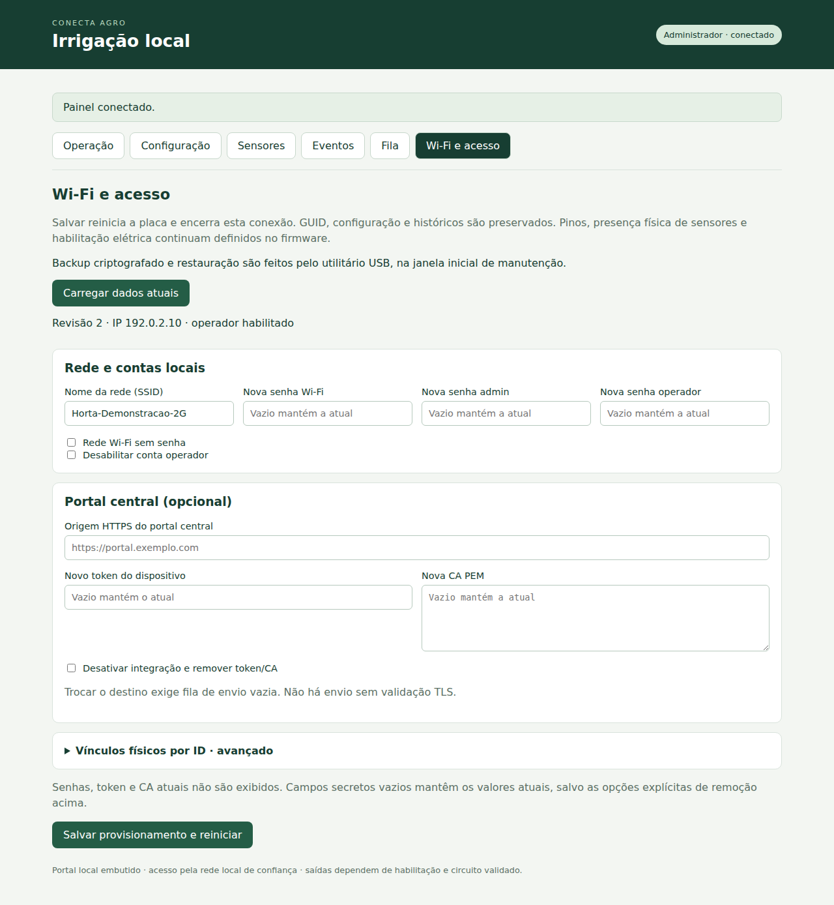

Em **Wi-Fi e acesso**, clique em **Carregar dados atuais** para obter SSID, revisão, IP e vínculos. As senhas, token e CA atuais não são exibidos.

### Alterar rede ou contas

1. Confira o SSID e preencha somente os segredos que deseja substituir.
2. Para rede aberta, use explicitamente **Rede Wi-Fi sem senha**.
3. Para remover o operador, use **Desabilitar conta operador**.
4. Clique em **Salvar provisionamento e reiniciar**.
5. Aguarde a reinicialização, reencontre o IP e autentique novamente se necessário.

**Campos secretos vazios mantêm os valores atuais**, salvo as opções explícitas de remoção. As senhas locais devem ter pelo menos 12 bytes, e a senha do operador deve ser diferente da admin. Salvar pode encerrar a conexão atual; isso é esperado. O IP pode mudar pelo DHCP.

Se perder Wi-Fi ou senha admin, utilize a recuperação física por USB na janela inicial de três minutos, conforme o [guia de primeiro acesso](../PRIMEIRO_ACESSO_ESP32.md). Não apague a NVS para tentar recuperar acesso.

### Conectar ao portal central

Preencha a origem **HTTPS**, um token individual do dispositivo e a CA PEM apropriada. O portal Node precisa estar alcançável por esse endereço; `localhost` do computador não representa o computador para o ESP32. Token da placa e conta humana do painel são identidades diferentes.

Para desligar a integração, use **Desativar integração e remover token/CA**. Mudar de destino exige fila vazia; uma alteração de credencial no mesmo destino conserva a fila. Não copie exemplos de token ou certificado como credenciais reais.

**Vínculos físicos por ID · avançado** associa IDs lógicos a canais já definidos pelo firmware. Não muda GPIO, polaridade, instalação de sensores ou habilitação elétrica. Configure somente com o mapa físico conferido.

## 11. Recuperação e backup

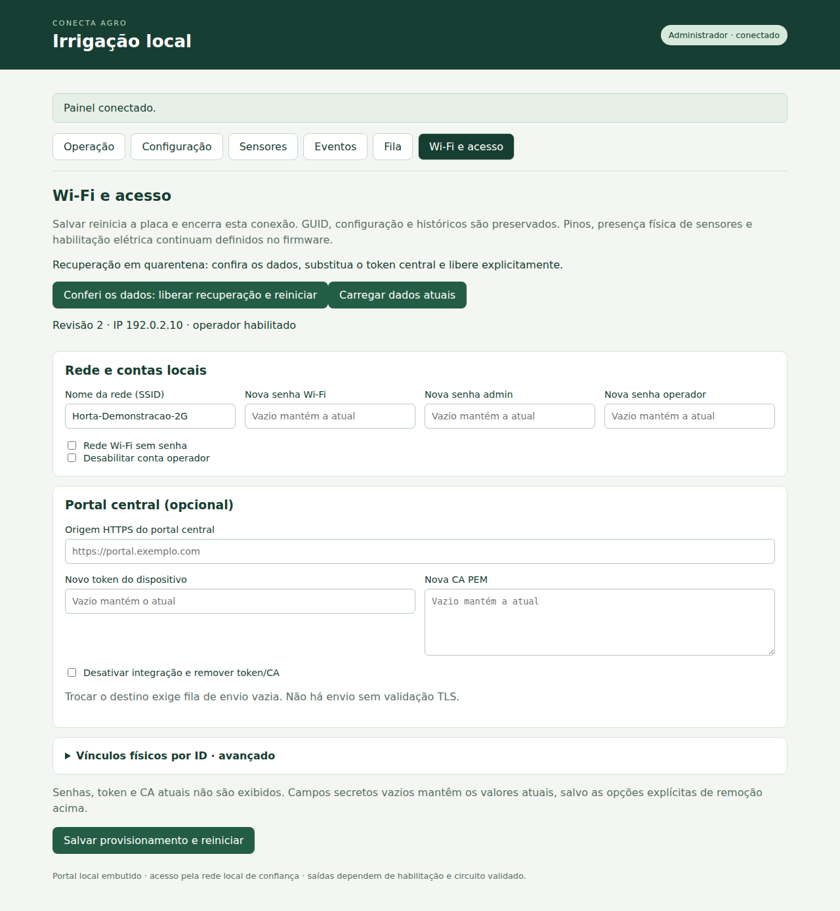

Backup e restauração são feitos pelo utilitário USB, não por **Exportar JSON**. O arquivo de backup é cifrado com senha externa e contém provisionamento, configuração e calibração. A restauração exige o mesmo GUID, valida revisões e mantém quarentena até a conferência/liberação.

Quando aparecer **Recuperação em quarentena**:

1. Confira a configuração, rede, contas e vínculos restaurados.
2. Se houver integração central, gere um novo token no portal central, substitua-o na placa e aguarde o reinício.
3. Use **Conferi os dados: liberar recuperação e reiniciar** somente após a conferência.
4. Aguarde o reinício e confirme o estado normal.

A integração ativa recusa liberar com o mesmo token do backup. O botão não deve ser usado para contornar uma recuperação com erro. Veja os comandos, limites e tratamento de manifesto parcial no [guia de recuperação e produção](../RECUPERACAO_E_PRODUCAO_ESP32.md).

O perfil hardened e a tabela candidata de produção não fazem parte do primeiro teste Wi-Fi. A segurança de produção ainda depende de SDK/bootloader/chaves, transporte protegido e validação física; a existência dessa tela não conclui essas etapas.

## 12. Uso pelo celular

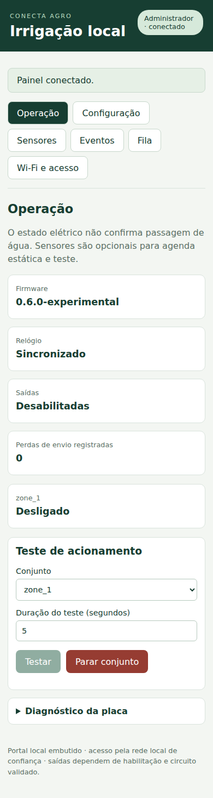

A mesma página reorganiza cartões, botões e formulários em tela estreita. Use o IP real da placa e uma rede que permita comunicação entre os clientes. Não é necessário instalar aplicativo. O celular pode indicar que o Wi-Fi não tem Internet; o acesso local e a sincronização do relógio são condições distintas.

## 13. Problemas frequentes

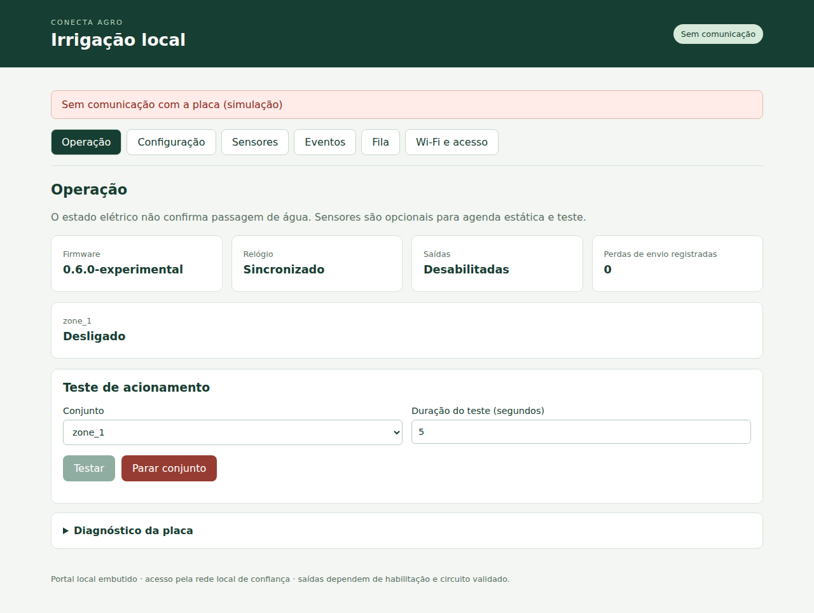

Sem comunicação, os cartões podem continuar mostrando a última resposta recebida. Eles não confirmam o estado atual da placa; aguarde a reconexão e confira novamente.

| Sintoma | O que conferir |
|---|---|
| Não abre o IP | Conexão 2,4 GHz da placa, IP atual no roteador/Serial, mesma rede alcançável e isolamento de clientes/convidados. |
| Credenciais recusadas | Usuário `admin` ou `operador`, senha cadastrada e eventual cache de autenticação do navegador. Recuperar por USB quando necessário. |
| Só aparecem duas abas | Acesso como operador: Operação e Eventos é o comportamento esperado. |
| Editor de configuração bloqueado | Autoridade do portal central/nó remoto, controlador ativo, permissão ou comunicação. |
| Testar está desabilitado | Saídas físicas, relógio, conjunto, recuperação, estado elétrico, permissão e conexão. |
| Calibração desabilitada | Perfil matriz, aquisição feita em outro nó, execução ativa ou falta de permissão. |
| Relógio aguardando sincronização | Wi-Fi e acesso aos servidores de tempo; o painel pode abrir mesmo sem sincronização. |
| A configuração mudou na placa | Conflito de revisão: exportar o rascunho se necessário, carregar a versão atual e revisar antes de aplicar. |
| Sessão/CSRF mudou | A placa pode ter reiniciado; atualizar/recarregar e conferir antes de repetir uma gravação. |
| Sem comunicação após salvar Wi-Fi | Reinício esperado; conferir nova rede, IP e senha. Não interpretar a desconexão como prova de falha ou sucesso. |
| Fila bloqueada | Destino, token, CA, relógio e conectividade; depois reprocessar conscientemente. |
| Mudança de destino recusada | Fila precisa estar vazia. Não cancelar mensagens sem conferir conteúdo/identificador e motivo. |
| Não libera recuperação | Token ainda igual ao do backup, erro de recuperação, execução ativa ou condição de segurança pendente. |

Em suporte, compartilhe versão, perfil, mensagem de erro e cenário. Não envie senhas, tokens, chave privada, arquivo de provisionamento ou backup com sua senha.

## 14. Como as imagens foram produzidas

As 16 imagens usam Chromium 149, a página `LocalPortalPage.h` do firmware 0.6.0 e dados sintéticos. Há páginas completas e recortes de painéis para manter os campos legíveis. Os recortes são capturas do navegador; o layout do produto não foi redesenhado para o manual.

A captura automática exercitou navegação, início/parada fictícios, alteração local de calendário, consulta de sensores, expansão/reenvio de evento, reprocessamento de fila, consulta de provisionamento, permissões e perda de conexão. Verificou ausência de erros JS, de requisições externas e de transbordamento horizontal em desktop/celular. Confira o [registro das capturas, dimensões e hashes](capturas.json).

Isso emula a **interface e respostas HTTP**. Não emula CPU ESP32, SDK, NVS, GPIO, autenticação Basic real, leituras físicas ou confirmação HTTPS central. As capturas não devem ser usadas como evidência de bancada ou de segurança de produção.

### Reproduzir as capturas

Na raiz do repositório, com Node 24+ e Playwright instalado em ambiente de desenvolvimento:

```sh
npm install --no-save --package-lock=false playwright@1.62.1
npx playwright install chromium
npm run manual:esp32
```

A geração substitui somente as imagens/registro deste manual, usa servidor temporário em `127.0.0.1`, encerra-o ao terminar e não abre uma porta da placa. A versão do Chromium instalado por esse comando pode diferir da usada nesta entrega. A ferramenta também aceita `UI_PLAYWRIGHT_MODULE`, `UI_BROWSER_EXECUTABLE` e `UI_BROWSER_ARGS` para um navegador já instalado. Para registrar a revisão de origem, definir `MANUAL_SOURCE_COMMIT` no ambiente.

O script é uma ferramenta de captura com cenários pré-definidos; operações fora desses cenários são recusadas pela API fictícia. Não é servidor de operação nem substitui os testes da placa.

### Documentação relacionada

- [Primeiro build, gravação, USB e Wi-Fi](../PRIMEIRO_ACESSO_ESP32.md)
- [Firmware, APIs e limites](../../firmware/README.md)
- [Recuperação, migrações e proteção](../RECUPERACAO_E_PRODUCAO_ESP32.md)
- [Auditoria de pré-produção](../AUDITORIA_PREPRODUCAO_ESP32.md)
- [Backlog do projeto](../../../BACKLOG.md)
